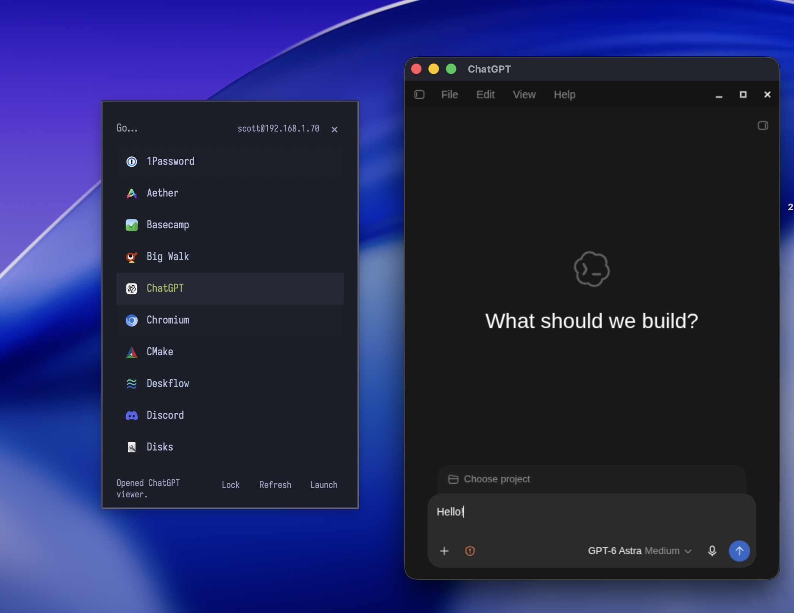

# Omarchy Remote Launchpad

Open Linux apps over SSH in native macOS windows. Search for an app and press Return to launch it. Pin its Dock icon to reopen it later.

## Get started

Download the macOS DMG and open Launchpad. **Manage Machines** opens on first run and is always available from the Omarchy menu bar icon. [GitHub releases](https://github.com/omarchy-launchpad/omarchy-remote-launchpad/releases)

- **Add Remote** saves an SSH alias or `user@host`. Verify the host fingerprint and set up SSH key login in Terminal. Use **Install agent** if needed, then click **Connect**. The host needs a running X11 or Xwayland desktop session.
- **Create VM** downloads the Try Omarchy runtime and starts a local VM. Requires Apple silicon and macOS 15 or later. Launchpad suggests your Mac short username and shows your Mac keyboard layout. Choose the account, password, and keyboard layout in Omarchy’s first-boot window. Sign in, confirm the guest username in Launchpad, then choose **Set up access…**. Try Omarchy carries over the Mac time zone, supported language, and keyboard type. Verify the guest fingerprint in Terminal before accepting it. Click **Connect** when setup finishes. Use **Open VM** to start the same VM again.
- **Remove** removes the saved machine and clears the current selection if it was active. VM disk files stay on disk.

To switch machines, select a saved row and click **Connect**. Closing a viewer leaves the Linux app running.

## Build from source

Requires macOS 13 or later, Rust, Apple command line tools, and the `x11-bridge` checkout next to this repo.

- `make run` builds and opens the macOS app. For an existing remote host, install `x11-bridge-agent` on the host's SSH login PATH or use **Install agent** with Docker.
- `make dev` rebuilds on changes and logs failures to `errors.txt`. For automatic agent installation, put an SSH alias or `user@host` in `omarchy-launchpad.local` and start Docker.
- `make check` runs formatting and lint checks. `make test` runs the test suite. Run `./scripts/test-native` for the Docker-backed AppKit and SSH tests.

Set `OMARCHY_LAUNCHPAD_CONFIG` to use a different target file.
